 

<a href="https://www.linkedin.com/in/kaushik-santhosh-96059b326"><b>LinkedIn</b></a>
&nbsp;&nbsp;·&nbsp;&nbsp;
<a href="mailto:kaushiksanthosh169@gmail.com"><b>Email</b></a>
&nbsp;&nbsp;·&nbsp;&nbsp;
<a href="https://github.com/Kaushik-web-arch"><b>GitHub</b></a>

  

<h3><code>kaushik@github:~$ whoami</code></h3>

<table>
<tr>
<td valign="top" width="350">

</td>
<td valign="top" width="510">

</td>
</tr>
</table>

### `kaushik@github:~$ ls ./featured-projects`

<table>
<tr>
<td width="50%" valign="top">

#### 01 · Zen Sports & Fitness
Paid client project delivered for a sports academy. The system manages student records, belt gradings, and certificate issuance.

`Streamlit` · `SQLAlchemy` · `Supabase`

</td>
<td width="50%" valign="top">

#### [02 · AI Research Agent](https://github.com/Kaushik-web-arch/ai-research-agent)
Agentic research workspace that plans focused searches, gathers live web evidence, and produces structured source-backed reports with local caching.

`Agentic AI` · `Gemini API` · `Python`

</td>
</tr>
<tr>
<td width="50%" valign="top">

#### [03 · Sentinel (SIH26103)](https://github.com/Kaushik-web-arch/sih103)
Team project that turns monthly government infrastructure reports into searchable project records, progress histories, and portfolio comparisons.

`React` · `FastAPI` · `PostgreSQL`

</td>
<td width="50%" valign="top">

#### [04 · Battery Monitoring App](https://github.com/Kaushik-web-arch/Battery-Monitoring-App)
Android hackathon app that measures screen-off battery drain, flags sessions above a user-set threshold, and saves recent readings on the device.

`Kotlin` · `Jetpack Compose` · `Android SDK`

</td>
</tr>
<tr>
<td width="50%" valign="top">

#### [05 · AI Digital Twin](https://github.com/Kaushik-web-arch/ai-digital-twin)
Context-grounded personal AI assistant that uses professional profile information with Gemini to answer questions about my background and projects.

`LLMs` · `Gemini API` · `Python`

</td>
<td width="50%" valign="top">

#### [06 · FinSight](https://github.com/Kaushik-web-arch/finsight-personal-finance-intelligence)
Personal-finance intelligence product spanning data ingestion, EDA, decision support, forecasting, risk classification, and anomaly detection.

`Machine Learning` · `Streamlit` · `Python`

</td>
</tr>
<tr>
<td width="50%" valign="top">

#### [07 · Student Placement Portal](https://github.com/Kaushik-web-arch/student-placement-porta)
Full-stack placement management system that keeps student records, placement drives, attendance, eligibility, and student access synchronized.

`Flask` · `MySQL` · `Python`

</td>
<td width="50%" valign="top">

#### [08 · Multi-Model SDR Outreach Agent](https://github.com/Kaushik-web-arch/Multi-model-sdr-outreach-agent)
Agentic SDR workflow where specialized Gemini and Groq agents generate outreach approaches, a manager agent evaluates the drafts, and the selected email moves through human review to Gmail delivery.

`Agentic AI` · `Gemini` · `Groq` · `Gradio` · `Python`

</td>
</tr>
</table>

<!-- PROJECTS_AUTO_START -->
### `kaushik@github:~$ ls ./all-projects`

This index is generated automatically from my public GitHub repositories that contain a README. Featured projects stay pinned above; newly published projects appear here automatically.

#### [Battery Monitoring App](https://github.com/Kaushik-web-arch/Battery-Monitoring-App)
An Android app that measures how much battery a phone loses while its screen is off. It shows the battery level before and after each session, the elapsed time, and the estimated drain in…

`Public repository` · `Kotlin` · [View repository](https://github.com/Kaushik-web-arch/Battery-Monitoring-App)

---

#### [Ghost Drain Hunter](https://github.com/Kaushik-web-arch/DAEMON-HOUR)
Ghost Drain Hunter records the battery level when the screen turns off and when it turns on again. It calculates the battery percentage points lost per hour, compares the result with a…

`Public repository` · [View repository](https://github.com/Kaushik-web-arch/DAEMON-HOUR)

---

#### [AI Digital Twin — Kaushik Santhosh](https://github.com/Kaushik-web-arch/ai-digital-twin) · **Featured**
A personal AI assistant that acts as a conversational representation of my professional profile. It uses my résumé/profile context together with Google&#x27;s Gemini model to answer questions…

`Public repository` · `Python` · [View repository](https://github.com/Kaushik-web-arch/ai-digital-twin)

---

#### [📈 FinSight — Intelligent Personal Finance Tracker](https://github.com/Kaushik-web-arch/finsight-personal-finance-intelligence) · **Featured**
A local personal finance application with a Streamlit interface and an educational data-science pipeline. It goes beyond CRUD: data ingestion → feature engineering → EDA → decision support…

`Public repository` · `Python` · [View repository](https://github.com/Kaushik-web-arch/finsight-personal-finance-intelligence)

---

#### [Multi-Model SDR Outreach Agent](https://github.com/Kaushik-web-arch/Multi-model-sdr-outreach-agent)
A focused agentic AI mini project that explores how multiple LLMs can work together inside an automated sales outreach workflow.

`Public repository` · `Python` · [View repository](https://github.com/Kaushik-web-arch/Multi-model-sdr-outreach-agent)

---

#### [Student Placement Portal](https://github.com/Kaushik-web-arch/student-placement-porta) · **Featured**
A full-stack placement management application that keeps student records, placement drives, attendance, eligibility, and student access synchronized between dedicated administrator and…

`Public repository` · `Python` · [View repository](https://github.com/Kaushik-web-arch/student-placement-porta)

---

#### [AI Research Agent](https://github.com/Kaushik-web-arch/ai-research-agent) · **Featured**
An agentic research workspace that converts a question into a structured, source-backed Markdown report. The application plans focused searches, collects current web evidence, extracts…

`Public repository` · `Python` · [View repository](https://github.com/Kaushik-web-arch/ai-research-agent)

---

#### [Sih103](https://github.com/Kaushik-web-arch/sih103)
Infrastructure project monitoring from monthly government reports. Sentinel turns reported project records into searchable snapshots, monthly history, portfolio comparisons, and…

`Public repository` · `Python` · [View repository](https://github.com/Kaushik-web-arch/sih103)
<!-- PROJECTS_AUTO_END -->

 

<h3><code>kaushik@github:~$ ./contributions.sh</code></h3>

  

<code>Building software at the intersection of AI, data, and practical applications.</code> 
<code>Currently exploring: Agentic AI · LLM systems · Full-stack development</code>

  

Profile art, contribution data, and the public project index refresh automatically with GitHub Actions.

